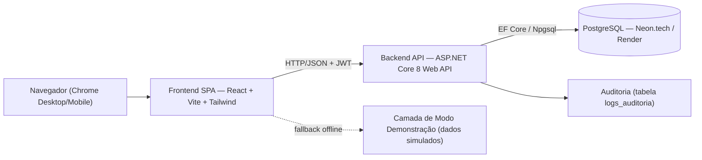
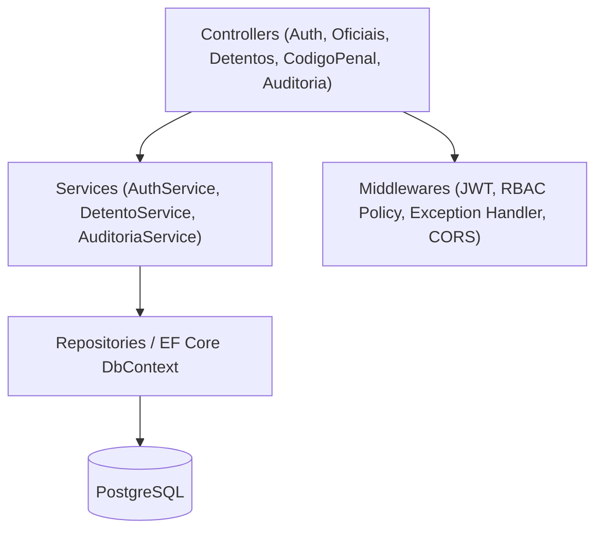
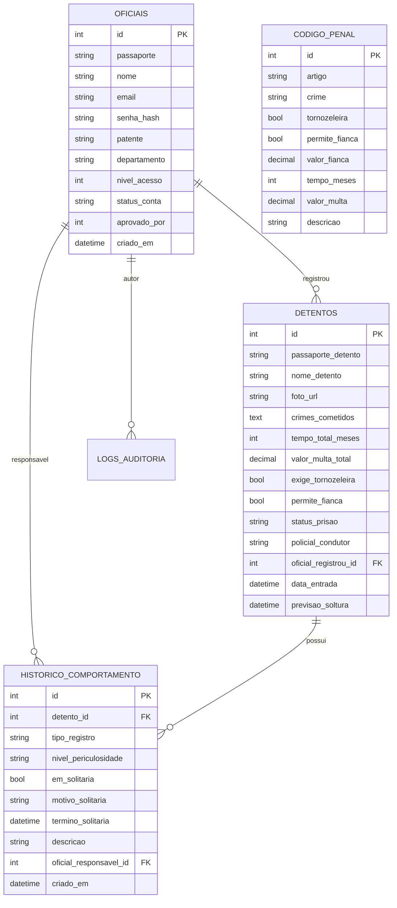

# Arquitetura Técnica — DCE (Departamento de Custódia do Estado)

## 1. Desenho da Arquitetura

Aplicação full-stack em duas camadas independentes: **frontend SPA (React)** consumindo uma **API REST (.NET 8)** que persiste em **PostgreSQL**. O frontend possui ainda uma camada de *fallback* de demonstração (modo demo) que permite navegar por todas as telas sem backend ativo.



## 2. Descrição das Tecnologias

**Frontend (`/Frontend`)**
- React 18 + TypeScript + Vite
- Tailwind CSS 3 (tema tático custom: azul-marinho, grafite, dourado)
- React Router DOM (rotas protegidas por nível de acesso)
- Zustand (estado global: sessão/autenticação)
- lucide-react (ícones)
- Cliente HTTP próprio (`fetch`) com injeção de `Authorization: Bearer <JWT>`
- Camada `demoStore` (dados simulados + persistência em `localStorage`) ativada automaticamente quando a API está inacessível

**Backend (`/Backend`)**
- .NET 8 / ASP.NET Core Web API
- Entity Framework Core 8 + Npgsql (provider PostgreSQL)
- Autenticação JWT (`Microsoft.AspNetCore.Authentication.JwtBearer`)
- Hash de senha com BCrypt.Net-Next
- Swagger/OpenAPI para documentação dos endpoints
- Autorização baseada em *policies* por `nivel_acesso` (RBAC)
- Middleware de tratamento de exceções + CORS configurável

**Banco de Dados**
- PostgreSQL 15+ (compatível com Neon.tech e Render)
- Script `schema.sql` (DDL + seed) e Migrations do EF Core

> **Observação de ambiente:** este ambiente não possui o SDK do .NET nem PostgreSQL instalados. O backend C# é entregue como código-fonte completo e deployável (Render/Railway/local com `dotnet`). O frontend roda imediatamente via Vite e opera em **modo demonstração automático** quando a API não responde.

## 3. Definições de Rotas (Frontend)

| Rota | Propósito | Acesso |
|------|-----------|--------|
| `/` | Página inicial pública + consulta de ficha | Público |
| `/login` | Autenticação de oficiais | Público |
| `/cadastro` | Solicitação de cadastro | Público |
| `/painel` | Dashboard de presos ativos | Nível 1, 2, 3 |
| `/painel/novo` | Cadastro de novo detento + calculadora penal | Nível 1, 2, 3 |
| `/painel/detento/:id` | Detalhe, gestão e linha do tempo do detento | Nível 1, 2, 3 |
| `/painel/codigo-penal` | Consulta/gestão do código penal | Ver: 1,2,3 / Editar: 1 |
| `/comando/aprovacoes` | Aprovar/recusar cadastros e atribuir patente | Nível 1 |
| `/comando/oficiais` | Gestão de oficiais (promover/rebaixar/bloquear) | Nível 1 |
| `/comando/auditoria` | Logs de auditoria | Nível 1 |
| `/comando/estatisticas` | Indicadores gerais | Nível 1 |

## 4. Definições da API (Backend)

**Autenticação**
```ts
// POST /api/auth/login
type LoginRequest  = { identificador: string; senha: string }        // e-mail OU passaporte
type LoginResponse = { token: string; oficial: OficialDTO }

// POST /api/auth/register
type RegisterRequest = { passaporte: string; nome: string; email: string; departamento: string; senha: string }

// GET /api/auth/me  -> OficialDTO
```

**Consulta pública**
```ts
// GET /api/public/ficha/{passaporte}
type FichaPublicaResponse = {
  encontrado: boolean;
  nome?: string;
  passaporte?: string;
  statusAtual?: 'EM_CUSTODIA' | 'LIBERADO' | 'FORAGIDO' | 'TORNOZELEIRA';
  passagens?: { artigo: string; crime: string; tempoMeses: number; multa: number; dataEntrada: string }[];
}
```

**Oficiais (Comando — Nível 1)**
```ts
GET    /api/oficiais                      // lista todos
GET    /api/oficiais/pendentes            // cadastros PENDENTE
POST   /api/oficiais/{id}/aprovar         // { patente, departamento, nivelAcesso }
POST   /api/oficiais/{id}/recusar
PUT    /api/oficiais/{id}                 // { patente?, nivelAcesso?, statusConta? }
DELETE /api/oficiais/{id}
```

**Detentos**
```ts
GET    /api/detentos?busca=               // filtro por nome/passaporte (comandos: N1..N3)
GET    /api/detentos/{id}
POST   /api/detentos                      // N1..N3 — cria ficha (calcula totais no servidor)
PUT    /api/detentos/{id}                 // N2, N1
POST   /api/detentos/{id}/baixa           // N2, N1 — { motivo }
DELETE /api/detentos/{id}                 // N1
```

**Comportamento / Solitária**
```ts
POST /api/detentos/{id}/comportamento
// { tipoRegistro: 'BOM_COMPORTAMENTO'|'MAU_COMPORTAMENTO'|'SOLITARIA',
//   nivelPericulosidade, emSolitaria, motivoSolitária?, terminoSolitária?, descricao }
GET  /api/detentos/{id}/historico
```

**Código Penal**
```ts
GET    /api/codigo-penal                  // todos os artigos
POST   /api/codigo-penal                  // N1
PUT    /api/codigo-penal/{id}             // N1
DELETE /api/codigo-penal/{id}             // N1
```

**Auditoria & Estatísticas (Nível 1)**
```ts
GET /api/auditoria?pagina=1&tamanho=25
GET /api/estatisticas
```

### 4.1 Envelope de erro padrão
```ts
type ApiError = { erro: string; mensagem: string; statusCode: number }
```

## 5. Diagrama do Servidor (Backend)



## 6. Modelo de Dados

### 6.1 Diagrama ER



### 6.2 Linguagem de Definição de Dados (DDL)

O script completo (com tipos ENUM, índices e *seed* do código penal) está em [`/Backend/schema.sql`](file:///c:/Users/guilh/Desktop/DCE/DCE-ONLINE/DCE_Online/Backend/schema.sql). Resumo das tabelas:

```sql
-- oficiais
CREATE TABLE oficiais (
  id            SERIAL PRIMARY KEY,
  passaporte    VARCHAR(32) UNIQUE NOT NULL,
  nome          VARCHAR(120) NOT NULL,
  email         VARCHAR(160) UNIQUE NOT NULL,
  senha_hash    VARCHAR(255) NOT NULL,
  patente       VARCHAR(60)  NOT NULL DEFAULT 'Recruta',
  departamento  VARCHAR(60)  NOT NULL DEFAULT 'Departamento de Custódia do Estado',
  nivel_acesso  SMALLINT     NOT NULL DEFAULT 3 CHECK (nivel_acesso IN (1,2,3)),
  status_conta  VARCHAR(20)  NOT NULL DEFAULT 'PENDENTE'
                CHECK (status_conta IN ('PENDENTE','ATIVO','BLOQUEADO')),
  aprovado_por  INTEGER REFERENCES oficiais(id) ON DELETE SET NULL,
  criado_em     TIMESTAMPTZ  NOT NULL DEFAULT NOW()
);

-- codigo_penal
CREATE TABLE codigo_penal (
  id              SERIAL PRIMARY KEY,
  artigo          VARCHAR(40)  NOT NULL,
  crime           VARCHAR(160) NOT NULL,
  tornozeleira    BOOLEAN      NOT NULL DEFAULT FALSE,
  permite_fianca  BOOLEAN      NOT NULL DEFAULT TRUE,
  valor_fianca    NUMERIC(12,2) NOT NULL DEFAULT 0,
  tempo_meses     INTEGER      NOT NULL DEFAULT 0,
  valor_multa     NUMERIC(12,2) NOT NULL DEFAULT 0,
  descricao       TEXT
);

-- detentos
CREATE TABLE detentos (
  id                     SERIAL PRIMARY KEY,
  passaporte_detento     VARCHAR(32)  NOT NULL,
  nome_detento           VARCHAR(120) NOT NULL,
  foto_url               TEXT,
  crimes_cometidos       TEXT         NOT NULL DEFAULT '[]',
  tempo_total_meses      INTEGER      NOT NULL DEFAULT 0,
  valor_multa_total      NUMERIC(12,2) NOT NULL DEFAULT 0,
  exige_tornozeleira     BOOLEAN      NOT NULL DEFAULT FALSE,
  permite_fianca         BOOLEAN      NOT NULL DEFAULT TRUE,
  status_prisao          VARCHAR(20)  NOT NULL DEFAULT 'EM_CUSTODIA'
                         CHECK (status_prisao IN ('EM_CUSTODIA','LIBERADO','FORAGIDO')),
  policial_condutor      VARCHAR(120),
  oficial_registrou_id   INTEGER REFERENCES oficiais(id) ON DELETE SET NULL,
  data_entrada           TIMESTAMPTZ  NOT NULL DEFAULT NOW(),
  previsao_soltura       TIMESTAMPTZ,
  nivel_periculosidade   VARCHAR(15)
                         CHECK (nivel_periculosidade IN ('BAIXO','MODERADO','ALTO'))
);

-- historico_comportamento
CREATE TABLE historico_comportamento (
  id                     SERIAL PRIMARY KEY,
  detento_id             INTEGER NOT NULL REFERENCES detentos(id) ON DELETE CASCADE,
  tipo_registro          VARCHAR(30) NOT NULL
                         CHECK (tipo_registro IN ('BOM_COMPORTAMENTO','MAU_COMPORTAMENTO','SOLITARIA')),
  nivel_periculosidade   VARCHAR(15) CHECK (nivel_periculosidade IN ('BAIXO','MODERADO','ALTO')),
  em_solitaria           BOOLEAN NOT NULL DEFAULT FALSE,
  motivo_solitaria       TEXT,
  termino_solitaria      TIMESTAMPTZ,
  descricao              TEXT,
  oficial_responsavel_id INTEGER REFERENCES oficiais(id) ON DELETE SET NULL,
  criado_em              TIMESTAMPTZ NOT NULL DEFAULT NOW()
);

-- logs_auditoria (extra, para o requisito de auditoria do Comando)
CREATE TABLE logs_auditoria (
  id           SERIAL PRIMARY KEY,
  oficial_id   INTEGER REFERENCES oficiais(id) ON DELETE SET NULL,
  acao         VARCHAR(80) NOT NULL,
  entidade     VARCHAR(40) NOT NULL,
  entidade_id  INTEGER,
  detalhe      TEXT,
  criado_em    TIMESTAMPTZ NOT NULL DEFAULT NOW()
);
```

### 6.3 Regras de Negócio da Calculadora Penal
- **Tempo total (meses)** = `Σ tempo_meses` dos artigos marcados → `previsao_soltura = data_entrada + (tempo_total_meses × 30 dias)`.
- **Multa total** = `Σ valor_multa`.
- **Tornozeleira** = `TRUE` se qualquer artigo marcado exigir monitoramento.
- **Fiança:** `Permitida` com valor = `Σ valor_fianca` dos artigos fiançáveis; torna-se `Inafiançável` se qualquer artigo bloqueá-la.
- **RBAC:** validação de nível no backend (policies) e espelhada no frontend (rotas protegidas).

## 7. Estrutura de Pastas

```
DCE_Online/
├── .trae/documents/            # PRD e Arquitetura (este documento)
├── Frontend/                   # React + Vite + Tailwind
│   ├── src/
│   │   ├── components/         # UI reutilizável (Layout, Cards, Badges, Modal...)
│   │   ├── pages/              # Rotas/telas
│   │   ├── services/           # api.ts (fetch + JWT) e demoStore (modo demo)
│   │   ├── store/              # zustand (sessão)
│   │   ├── types/              # tipos compartilhados
│   │   └── utils/              # helpers (datas, formatadores, cálculo penal)
│   └── ...
└── Backend/                    # ASP.NET Core 8 Web API
    ├── Controllers/
    ├── Models/ (Entities)      # + DTOs
    ├── Data/                   # DbContext + seed
    ├── Services/               # JWT, Auth, Auditoria, Detento
    ├── Migrations/
    ├── schema.sql              # DDL + seed (Neon/Render)
    └── appsettings.json        # ConnectionStrings + Jwt
```

## 8. Configuração da String de Conexão (Passo a Passo)

1. **Criar o banco gratuito** em [neon.tech](https://neon.tech) → *New Project* → copie a *Connection String* (`Host=...;Database=...;Username=...;Password=...;SSL Mode=Require`).
2. **Definir a conexão** de uma das formas:
   - Em `Backend/appsettings.Development.json`:
     ```json
     { "ConnectionStrings": {
         "DefaultConnection": "Host=ep-xxxx.us-east-1.aws.neon.tech;Port=5432;Database=neondb;Username=user;Password=senha;SSL Mode=Require;Trust Server Certificate=true"
     }}
     ```
   - Em `Backend/appsettings.json` (valor padrão já presente, para desenvolvimento local):
     ```json
     { "ConnectionStrings": {
         "DefaultConnection": "Host=localhost;Port=5432;Database=dce_online;Username=postgres;Password=postgres;SSL Mode=Prefer"
     }}
     ```
   - Ou via variável de ambiente (recomendado em produção):
     ```powershell
     $env:ConnectionStrings__DefaultConnection="Host=...;Database=...;Username=...;Password=...;SSL Mode=Require"
     ```
3. **Provisionar o schema** (escolha UMA forma):
   - **A. Script SQL (sem SDK):** `psql "<connection-string>" -f Backend\schema.sql` — cria as tabelas e já popula os dados de exemplo.
   - **B. AutoMigrate (com SDK .NET 8):** defina `"Database": { "AutoMigrate": true, "AutoSeed": true }` em `appsettings.json` e inicie a API; o EF Core cria as tabelas a partir dos models e o `DbSeeder` popula os dados.
4. **Definir a chave JWT** em `appsettings.json` (`Jwt:Key`, ≥ 32 caracteres).
5. **Executar a API:** `dotnet run --project Backend` → porta `http://localhost:5080` (Swagger em `http://localhost:5080/swagger`; HTTPS em `https://localhost:7080`).
6. **Apontar o frontend:** crie `Frontend/.env` com `VITE_API_URL=http://localhost:5080/api`. Se a API não responder, o frontend entra em **modo demonstração** automaticamente.
