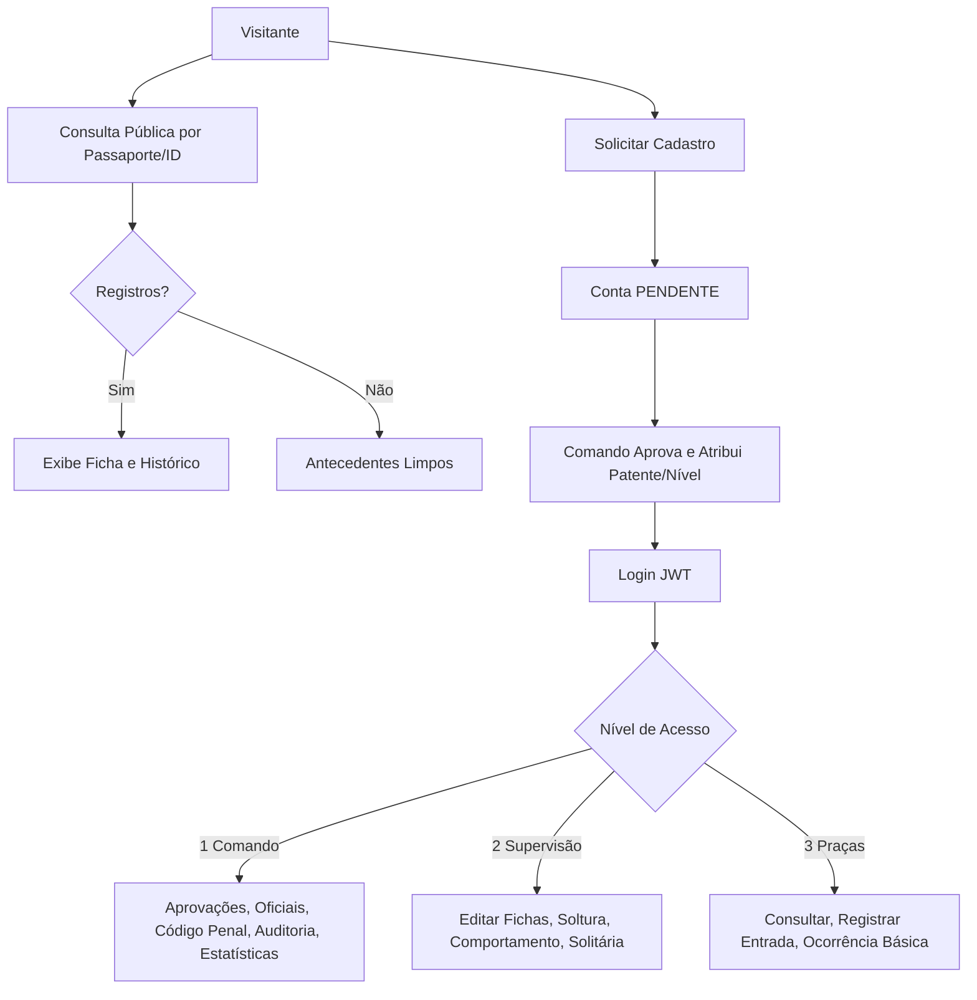

# PRD — Departamento de Custódia do Estado (DCE)

## 1. Visão Geral do Produto

Sistema web institucional de gestão penitenciária para servidores de **GTA RP**, cobrindo desde a consulta pública de antecedentes criminais até o controle operacional completo de detentos, regime disciplinar e hierarquia de oficiais.

- **Propósito:** centralizar fichas criminais, cálculo de penas com base no código penal do servidor, controle de presos ativos, disciplina (solitária / periculosidade) e o controle de acesso por patente (RBAC), substituindo planilhas e anotações soltas.
- **Público-alvo:** cidadãos e advogados (consulta pública), policiais condutores (PM/PC) e oficiais do DCE em três níveis hierárquicos.

## 2. Funcionalidades Centrais

### 2.1 Papéis de Usuário

| Papel | Forma de Acesso | Permissões Principais |
|------|-----------------|------------------------|
| Visitante (Público) | Sem login | Consultar ficha criminal por Passaporte/ID |
| Nível 3 — Praças e Graduações (`Agente do Estado`, `1º/2º Sargento`, `Cabo`, `1º/2º Soldado`, `Recruta`) | Cadastro aprovado pelo Comando | Consultar fichas, registrar novas entradas de presos, adicionar ocorrências básicas de comportamento |
| Nível 2 — Oficialidade e Supervisão (`Coronel`, `Ten. Coronel`, `Major`, `Capitão`, `1º/2º Tenente`, `Sub.Tenente`, `Supervisor do Estado`) | Cadastro aprovado / promoção | Tudo do nível 3 + editar fichas, dar baixa em libertações, registrar ocorrências, gerenciar solitária e periculosidade |
| Nível 1 — Comando / Staff (`COMANDO`, `Diretor Geral`, `Diretor Executivo`) | Cadastro / definido pela staff | Acesso total: aprovar cadastros, promover/rebaixar patentes, excluir/corrigir fichas, gerenciar código penal, ver logs de auditoria e estatísticas gerais |

### 2.2 Módulos do Sistema

1. **Página Inicial Pública**: hero de consulta, barra de busca por Passaporte/ID, painel de resultado da ficha, atalhos de acesso restrito.
2. **Autenticação & Controle de Contas**: Login (e-mail ou passaporte + senha → JWT), Solicitação de Cadastro (status `PENDENTE`), Painel de Aprovação do Comando.
3. **Painel Operacional do Presídio**: Dashboard de presos ativos com filtro instantâneo, Cadastro de Novo Detento com Calculadora do Código Penal, Detalhe/Gestão da Ficha.
4. **Comportamento, Periculosidade e Solitária**: nível de periculosidade com indicador visual, controle de regime disciplinar (solitária com motivo e prazo obrigatórios), linha do tempo disciplinar.
5. **Administração do Comando**: Gestão de Oficiais (promover/rebaixar/bloquear), Gestão do Código Penal, Logs de Auditoria, Estatísticas.

### 2.3 Detalhamento das Páginas

| Nome da Página | Módulo | Descrição da Funcionalidade |
|----------------|--------|------------------------------|
| Início (Pública) | Hero de Consulta | Campo de destaque para digitar Passaporte/ID; validação e busca instantânea |
| Início (Pública) | Painel de Resultado | Exibe Nome, Passaporte, Status Atual (Preso / Em Liberdade / Tornozeleira) e histórico de passagens com artigos e penas; estado vazio "Nenhuma ficha penal encontrada..." |
| Início (Pública) | Acesso Restrito | Botões "Entrar (Login de Oficiais)" e "Solicitar Cadastro" |
| Login | Formulário | Autenticação por e-mail/passaporte + senha, geração e persistência de JWT, mensagens de erro (conta pendente/bloqueada) |
| Cadastro | Formulário | Passaporte/ID, Nome Completo (RP), E-mail, Senha; cria conta `PENDENTE` bloqueada para login |
| Dashboard Operacional | Filtro & Lista | Busca instantânea por Nome ou Passaporte; cards/tabela responsiva com tempo restante de pena, status e ações rápidas |
| Nova Ficha de Detento | Identificação | Nome (RP), Passaporte/ID, Link da Foto (Mugshot) |
| Nova Ficha de Detento | Calculadora do Código Penal | Seleção múltipla de artigos; cálculo automático de tempo total (meses), previsão de soltura, multa total, alerta de tornozeleira e status de fiança |
| Nova Ficha de Detento | Auditoria do Registro | Órgão/Policial Condutor (PM/PC) + preenchimento automático do oficial logado via token |
| Detalhe do Detento | Ficha Completa | Dados, crimes, status, foto, tempo restante e previsão de soltura |
| Detalhe do Detento | Comportamento & Periculosidade | Seletor de periculosidade com indicador (🟢/🟡/🔴) e linha do tempo disciplinar (Bom/Mau comportamento) |
| Detalhe do Detento | Regime Disciplinar (Solitária) | Ativar isolamento exigindo motivo e prazo; encerrar isolamento |
| Detalhe do Detento | Ações Rápidas | Registrar ocorrência, editar ficha, dar baixa/soltura, excluir (Comando) |
| Aprovação de Cadastros (Comando) | Fila de Pendentes | Lista de solicitações, aprovação/recusa e atribuição imediata de patente + nível de acesso |
| Gestão de Oficiais (Comando) | Tabela de Oficiais | Promover/rebaixar, alterar patente/nível, bloquear/desbloquear e excluir |
| Código Penal (Comando) | CRUD de Artigos | Criar/editar/excluir artigos (crime, tempo, multa, torna/fiança, descrição) |
| Logs de Auditoria (Comando) | Tabela de Logs | Registro cronológico de ações sensíveis (quem, o quê, quando) |
| Estatísticas (Comando) | Painel de Indicadores | Total de detentos, presos ativos, liberados, foragidos, em solitária, oficiais ativos, pendentes |

## 3. Fluxos Principais

**Fluxo 1 — Consulta pública:** Visitante digita Passaporte/ID → sistema consulta fichas → exibe status e histórico ou mensagem de antecedentes limpos.

**Fluxo 2 — Onboarding de oficial:** Recruta solicita cadastro → conta fica `PENDENTE` → Comando aprova e atribui patente/nível → oficial faz login e acessa conforme nível.

**Fluxo 3 — Registro de detento:** Oficial (N3+) abre Nova Ficha → informa dados → marca artigos → calculadora gera pena/multa/tornozeleira/fiança → salva ficha → detento aparece no dashboard.

**Fluxo 4 — Disciplina e soltura:** N2+ registra ocorrência, altera periculosidade, envia à solitária (motivo + prazo) → N2+ dá baixa/libertação.

## 4. Interface e Design

### 4.1 Estilo de Design
- **Paleta:** azul-marinho escuro (`#0A1628` / `#0F1E33`), cinza grafite (`#1B2230` / `#2A3441`), dourado institucional (`#C9A227` / `#E8C547`) como acento; vermelho/âmbar para alertas.
- **Botões:** cantos levemente arredondados (`rounded-md`), bordas sutis, efeito de relevo discreto e transições de hover; botões dourados para ações primárias.
- **Tipografia:** display condensada de estilo institucional/tático para títulos; corpo em fonte industrial legível; monospace para Passaportes/IDs e valores.
- **Layout:** desktop-first com barra lateral de navegação e cabeçalho institucional; cards com bordas e brilhos sutis; textura/grade de fundo discreta.
- **Ícones:** `lucide-react` em traço fino, tom dourado/cinza.
- **Alertas visuais:** tornozeleira (âmbar), inafiançável (vermelho), periculosidade (🟢/🟡/🔴), preso/liberado/foragido (badges coloridos).

### 4.2 Visão Geral do Design das Páginas

| Página | Módulo | Elementos de UI |
|--------|--------|-----------------|
| Início | Hero de Consulta | Fundo com grade e vinheta, título institucional condensado, input grande com ícone de busca, botão dourado; animação de entrada em cascata |
| Início | Painel de Resultado | Card de ficha com badge de status, avatar/mugshot, tabela/lista de artigos e penas; micro-animação ao revelar |
| Login/Cadastro | Formulário | Card centralizado com borda dourada, inputs escuros, validação inline, mensagens de estado (pendente/bloqueado) |
| Dashboard | Lista de Presos | Barra de filtro fixa no topo, cards responsivos (1→4 colunas), barras de tempo restante, botões de ação rápida |
| Nova Ficha | Calculadora Penal | Grid de artigos selecionáveis, painel lateral "sticky" com totais animados (pena, multa, tornozeleira, fiança) |
| Detalhe | Ficha & Timeline | Cabeçalho com mugshot e badges, abas (Dados / Comportamento / Audi­toria), timeline vertical cronológica |
| Comando | Tabelas administrativas | Tabelas densas com filtro, ações em linha, confirmação modal para ações destrutivas |

### 4.3 Responsividade
- **Desktop-first** com layout de barra lateral fixa; em telas menores a barra vira menu deslizante (drawer).
- **Mobile:** cards empilhados, tabelas convertidas em listas/cards, painéis "sticky" passam a blocos, botões com área de toque ≥ 44px.
- **Touch:** estados de foco/hover acessíveis, sem dependência de hover para ações críticas.

## 5. Requisitos Não Funcionais
- **Segurança:** senhas com hash (BCrypt), autenticação JWT, autorização por nível (RBAC) no backend, validação também no frontend.
- **Auditoria:** toda ação sensível registrada (autor, ação, alvo, timestamp).
- **Compatibilidade:** Google Chrome (desktop e mobile universal).
- **Observabilidade mínima:** respostas de erro padronizadas e mensagens claras ao usuário.
